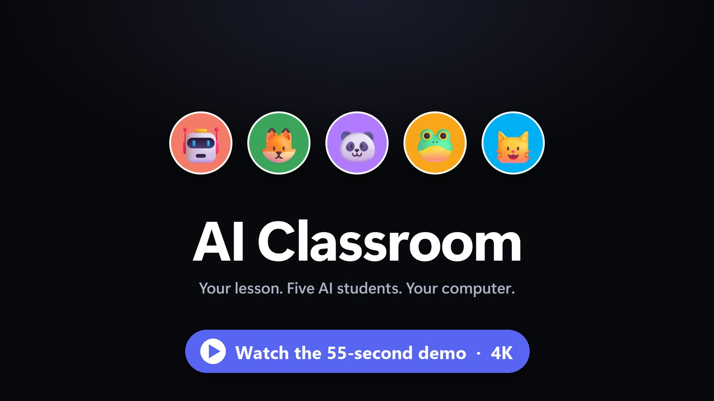

# 🎓 Learning Local AI — the AI Classroom

A classroom game where **you are the Teacher** and **5 small AI students** quiz you about any lesson you give them:
a PDF, your notes, a picture of a page, or some pasted text.

Everything runs **on your own computer** with [llama.cpp](https://github.com/ggml-org/llama.cpp). No internet and no account needed after setup.

### 🎬 See it in action

[](https://www.youtube.com/watch?v=JJG4vCcJN0M)

▶️ **[Watch the 55-second demo on YouTube](https://www.youtube.com/watch?v=JJG4vCcJN0M)**: the real app with the 5 AI students, recorded live.

| The students | |
|---|---|
| 🤖 **Byte** | nerdy and precise, loves numbers and exact facts |
| 🦊 **Pixel** | super curious, always asks why and how |
| 🐼 **Mochi** | calm, explains with everyday comparisons |
| 🐸 **Ribbit** | funny and playful, but keeps the facts right |
| 🐱 **Whiskers** | careful, likes tricky "what if" questions |

---

## ⬇️ Download

1. Go to the **[Releases page](https://github.com/Yasukiii1/learning-local-ai/releases/latest)**.
2. Download **`Learning-Local-AI.zip`** (under *Assets*).
3. Right-click the zip → **Extract All…** and put the folder anywhere, for example on your Desktop.

> The green **Code → Download ZIP** button only gives you the source code. Use the Releases page to get the ready-to-run `AI-Classroom.exe`.

---

## ✅ Requirements

| | |
|---|---|
| **System** | Windows 10 or 11 (64-bit) |
| **Graphics card** | **8 GB VRAM or more** (NVIDIA, AMD or Intel) |
| **llama.cpp** | already installed, a **recent build** (build 12196 from November 2026 or newer, it needs LFM3 support) |
| **Disk space** | about 2 GB (the model is 1.0–1.4 GB) |
| **Memory (RAM)** | 16 GB recommended |

`AI-Classroom.exe` uses Microsoft Edge WebView2, which is already built into Windows 10 and 11.

---

## 🚀 Quick start

Do these steps inside the extracted `Learning-Local-AI` folder.

| Step | What to do |
|---|---|
| **1** | Double-click **`download_model.bat`**. Press **1** for an 8 GB graphics card, or **2** for 12 GB or more. It downloads the student model into the `models` folder. |
| **2** | *Only if `llama-server` is **not** on your PATH:* open **`student_settings.bat`** with Notepad and fill in the full path to `llama-server.exe`. |
| **3** | Double-click **`start_students.bat`**. Five windows open (one per student). Wait until each one says `listening on http://127.0.0.1:...`. |
| **4** | Double-click **`AI-Classroom.exe`**. |
| **5** | Click **☰** (top-left), then **📚 Lessons**. Upload a file or paste text (try the files in `sample_lessons`), click the lesson, and press **✓ Select**. |

The students read the lesson (about 15–30 seconds), then the **Class** tab opens. Read the class notes and the sticky notes, then press **Start class** (or **Enter**) when you're ready. Type your answers at the bottom and press **Enter**.

📘 **Need more detail on the 5 student models?** See **[SETUP_STUDENTS.md](SETUP_STUDENTS.md)**.

When you're done, double-click **`stop_students.bat`** to free up your graphics card.

---

## 🧑‍🎓 Run the student models yourself (you already have llama.cpp)

The `.bat` files above do all of this for you. If you'd rather run the models yourself, here is everything they do.
The 5 students are **5 copies of one small model** ([LFM3-1.7B](https://huggingface.co/LiquidAI/LFM3-1.7B-GGUF)),
each in its own `llama-server` on ports **1001–1005**. The app talks to them there.

**1. Check llama.cpp.** You need build **12196 or newer** (older builds don't know LFM3):

```powershell
llama-server --version
```

**2. Get the model.** Download **one** file from [LiquidAI/LFM3-1.7B-GGUF](https://huggingface.co/LiquidAI/LFM3-1.7B-GGUF/tree/main)
into the `models` folder: `LFM3-1.7B-Q4_K_M.gguf` for 8 GB VRAM, or `LFM3-1.7B-Q6_K.gguf` for 12 GB or more.
All 5 students share this one file.

**3. Start the 5 students.** Open **PowerShell** in the `Learning-Local-AI` folder and paste this. Change the two
paths at the top if yours are different:

```powershell
$server = "llama-server"                         # or the full path, e.g. "C:\llama.cpp\llama-server.exe"
$model  = (Resolve-Path ".\models\LFM3-1.7B-Q4_K_M.gguf").Path   # the model you downloaded
1..5 | ForEach-Object {
  Start-Process $server -ArgumentList "-m `"$model`" -c 12000 --parallel 2 -ngl 99 -fa on --cache-type-k q8_0 --cache-type-v q8_0 --threads 3 --jinja --temp 0.1 --top-k 50 --top-p 1.0 --min-p 0 --repeat-penalty 1.1 --alias student$_ --port 100$_"
  Start-Sleep 3
}
```

| Option | Why |
|---|---|
| `-c 12000` | each student's memory. Use `20000` with 12 GB VRAM or more. |
| `--parallel 2` | 2 slots per student: one answers you, the other writes the next questions and notes in the background. **Keep it.** |
| `-ngl 99` | the whole model on the graphics card. If students crash with `out of memory`, try `22`, then `18`. |
| `--temp 0.1` | keeps the students careful and factual. |
| `--port 1001`…`1005` | the app expects these ports (Byte, Pixel, Mochi, Ribbit, Whiskers). |

**4. Check they're ready.** All 5 should say `ok`:

```powershell
foreach ($p in 1001..1005) { try { "port $p : " + (Invoke-RestMethod "http://127.0.0.1:$p/health").status } catch { "port $p : not ready" } }
```

Then open `AI-Classroom.exe`.

**5. Stop them** when you're done. This only closes the servers on ports 1001–1005; any other llama.cpp server keeps
running:

```powershell
1001..1005 | % { Get-NetTCPConnection -LocalPort $_ -State Listen -ErrorAction SilentlyContinue | % { Stop-Process -Id $_.OwningProcess -Force } }
```

More detail and fixes for common problems: **[SETUP_STUDENTS.md](SETUP_STUDENTS.md)**.

---

## ✨ New in v1.1

- **Class lobby:** before class, the Class tab shows a chalkboard with the lesson and a **Start class** button, so you can read first.
- **📒 Class notes:** the 5 students write combined notes for the whole class, with tidy blocks (big idea, key points, key words, steps, formulas, examples, "watch out"). They also add a ★ quick recap. Open one section at a time and press **Got it · next**.
- **＋ More notes:** ask for extra sections about ideas the notes don't cover yet. Free students write a few ahead, so they appear after a short loading bar. Extra sections stay until you delete them (🗑, click twice).
- **🗒 Sticky notes:** key words to learn, as flip cards. Say the meaning, then click to check. The meanings are short (3–7 key words) with the important words in **bold**. The see-through **＋** note adds 2 more, up to 20.
- **Card deal:** pressing Start shuffles the sticky notes into the question counter.
- **Faster:** answers are marked in about a second. Explanations are written while you're still answering, and the first questions are written before class starts.
- **Better questions:** for 🔘 Pick one, the student names the right answer and the app shuffles the options itself. Before, the wrong option could get ticked. Cards with two right options are thrown away.
- **Spelling and grammar:** every instruction now ends with a spelling and grammar check, and the notes get an extra proofread.
- **🏠 Home** dashboard and **📝 Review** tab: missed, timed-out and ⭐ starred questions to practise again.

---

## 🏫 How the class works

- **Before class:** read the 📒 class notes (right) and test yourself with the 🗒 sticky notes (bottom left). Press **Start class** when you're ready.
- A new **question card** arrives every 10 seconds, and up to 9 are on screen. You have **30 seconds** for each one.
- After you answer, the right panel shows the answer, whether you were **✅ correct**, **🤏 partly right** or **❌ not quite**, and a **📖 explanation**.
- Still confused? Press **🤔 Still confused?** for an even simpler explanation (up to 2 more).
- Press **☆** to star a question and practise it again later in **📝 Review**.
- The students only ask about **your lesson**. Questions that use things outside the lesson are thrown away.
- Students with nothing to do help the others: they write the next questions, explanations, extra notes and sticky notes in the background.

**Card types:** 🧠 Explain why · 🔀 What if… · ⚖️ Compare · ✍️ Fill the blank · 🔘 Pick one · 🕵️ Spot the mistake · ⚡ Lightning (10 s) · 🗳️ Who's right?

**Special cards and events:**

| | |
|---|---|
| ⭐ **Gold challenge** | every 10th card, harder, 60 seconds |
| 🥈 **Silver** | every 5th card, a bit harder, 45 seconds |
| 🔥 **Streak card** | can appear when you have 3 or more correct in a row, worth +3 |
| ☄️ **Meteor** | after 10 answers, a meteor can strike a waiting card |
| 🧟 **Zombie** | after 20 answers, a zombie can bite a card. Answer it correctly before it spreads! If it reaches a gold card, it becomes the 👑 **Zombie Boss** (2 parts, +5 streak) |

The class lasts **15 minutes**. At the end, you get a report card.

---

## 📁 What's in the folder

(In this GitHub repo, the scripts are in the [`AI-Classroom`](AI-Classroom) folder and the exe is on the Releases page. The zip has them all together.)

```
Learning-Local-AI/
├── AI-Classroom.exe            ← the app
├── download_model.bat          ← step 1: downloads the student model
├── student_settings.bat        ← llama-server path, memory and GPU settings
├── start_students.bat          ← starts the 5 students (5 windows)
├── start_students_hidden.bat   ← the same, but in the background (no windows)
├── check_students.bat          ← are the 5 students ready?
├── stop_students.bat           ← stops the 5 students
├── models/                     ← the model goes here
├── sample_lessons/             ← lessons to try (calculus, volcanoes, local AI...)
├── README.md                   ← this file
└── SETUP_STUDENTS.md           ← detailed student setup
```

The app creates these folders by itself, next to the exe:

| Folder / file | What's inside |
|---|---|
| `lessons/` | your lessons, the students' plans, class notes and sticky notes |
| `sessions/` | a log of every class, plus questions you ran out of time on |
| `skills/` | the instructions the students follow (plain `.md` files you can edit with Notepad). When an update brings new instructions, your old copies are kept in `skills/old/` |
| `logs/` | app and student logs |
| `config.json` | settings such as class length, seconds per question and student names |

---

## ❓ Troubleshooting

| Problem | Fix |
|---|---|
| `Could not find llama-server.exe` | Set `LLAMA_SERVER` in `student_settings.bat` to the full path of `llama-server.exe`. |
| A student window closes straight away, or says `unknown model architecture` | Your llama.cpp is too old for LFM3. Download a newer build ([see SETUP_STUDENTS.md](SETUP_STUDENTS.md#1-check-your-llamacpp)). |
| `out of memory` / students crash | In `student_settings.bat`, lower `NGL` (try 22, then 18) or `CTX` (try 8000). Use the Q4_K_M model for 8 GB cards. |
| The app says the students are offline (grey icons at the bottom) | Run `check_students.bat`. Start them with `start_students.bat`, and wait until all 5 are ready. |
| Questions come very slowly | Close games and other GPU-heavy apps. The 5 students share your graphics card. |
| A picture or scanned PDF has no text | Windows OCR reads **printed** text only. For handwriting, type it into the text box instead. |
| Windows SmartScreen warns about the exe | Click **More info → Run anyway**. The app isn't signed because it's a hobby project. |

---

## 🛠️ Build from source (optional)

The source code is in the [`source`](source) folder (Python + pywebview + PyInstaller). See [`source/BUILD.md`](source/BUILD.md).

---

## 🙏 Credits

- Student model: **[LFM3-1.7B](https://huggingface.co/LiquidAI/LFM3-1.7B-GGUF)** by Liquid AI (downloaded from Hugging Face under its own license, not included here).
- Runs on **[llama.cpp](https://github.com/ggml-org/llama.cpp)**.
- Window: **[pywebview](https://pywebview.flowrl.com/)** · PDF reading: **[pypdf](https://github.com/py-pdf/pypdf)** · Pictures: Windows' built-in OCR.
